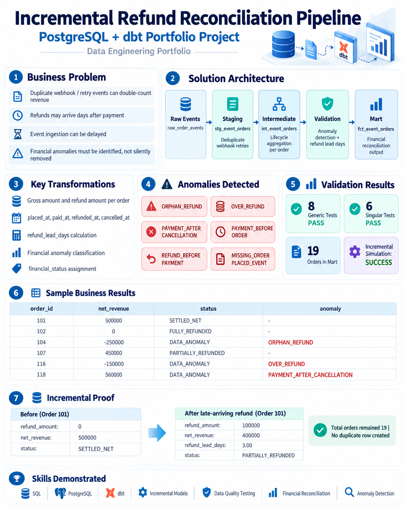

# Refund Reconciliation Mart — Incremental Pipeline with dbt

A PostgreSQL + dbt case study on the most under-reported revenue bug in e-commerce
reporting: **a GMV dashboard that is technically correct and commercially wrong**.



---

## The problem

A payment is not the end of a transaction. After the money lands, a customer can
return the goods and get refunded — often 3 to 7 days later. Meanwhile the payment
gateway retries webhooks on network hiccups, so the same event can arrive twice.

A mart built like this:

```sql
SELECT SUM(amount) FROM orders WHERE status = 'PAID'
```

overstates revenue on the day of payment and never corrects itself. Three failure
modes follow:

| Failure | Effect on Finance |
|---|---|
| Late-arriving refunds | GMV looks healthy, cash flow does not |
| Duplicate webhook retries | The same payment is counted twice |
| Integrity anomalies (orphan refunds, over-refunds) | Reported money does not exist at all |

## The approach

Three layers, each with one job:

| Layer | Model | Materialization | Responsibility |
|---|---|---|---|
| 1 | `stg_event_orders` | view | Deduplicate webhook retries (`ROW_NUMBER()` over the business key, ordered by `ingested_at`) |
| 2 | `int_event_orders` | ephemeral | Rebuild the order lifecycle with conditional aggregation (`MAX(CASE WHEN ...)`), calculate `refund_lead_days`, classify anomalies |
| 3 | `fct_event_orders` | incremental (`unique_key='order_id'`) | Net realized revenue + financial status per order, with a watermark for incremental runs |

Three deliberate decisions:

1. **Deduplicate on the business key, not the surrogate key.** `event_id` is generated
   by the producer; a retried webhook can arrive with a new id and an identical payload.
   The partition therefore uses `order_id, customer_id, event_type, amount, event_time`.
2. **Anomalies are classified, not dropped.** A refund with no payment is a genuine
   business event that Finance needs to see, so it is surfaced as `DATA_ANOMALY` with a
   reason code instead of being filtered out in staging.
3. **The watermark comes from `ingested_at`, not `event_time`.** Late-arriving events are
   only visible if ingestion time drives the incremental filter.

## Anomaly taxonomy

| Reason code | Definition |
|---|---|
| `ORPHAN_REFUND` | Refund exists without a confirmed payment |
| `OVER_REFUND` | Refunded amount exceeds the confirmed payment |
| `MISSING_ORDER_PLACED_EVENT` | Payment confirmed without any placement event |
| `PAYMENT_AFTER_CANCELLATION` | Payment settled after the order was cancelled |
| `PAYMENT_BEFORE_ORDER` | Payment timestamp precedes the placement timestamp |
| `REFUND_BEFORE_PAYMENT` | Refund timestamp precedes the payment timestamp |

## Data quality

12 tests, all green in a single `dbt build`:

* 8 generic tests (`not_null`, `unique`) on the event id and the mart grain
* 4 singular tests, one per business rule:
  * `assert_net_revenue_reconciliation` — net revenue equals gross minus refund
  * `assert_financial_status_consistency` — status matches the pricing/lifecycle rules
  * `assert_orphan_refund_classification` — orphan refunds are flagged
  * `assert_over_refund_classification` — over-refunds are flagged

## Results

45 raw events → **19 orders** in the mart, **6** of them flagged as financial anomalies.

| Financial status | Orders |
|---|---|
| SETTLED_NET | 5 |
| FULLY_REFUNDED | 3 |
| PARTIALLY_REFUNDED | 1 |
| CANCELLED_UNPAID | 2 |
| CANCELLED_PAID_REVIEW | 1 |
| PENDING_UNPAID | 1 |
| DATA_ANOMALY | 6 |

Example rows (`results/fct_event_orders.csv`):

| order_id | gross | refund | net revenue | status | anomaly |
|---|---|---|---|---|---|
| 101 | 500,000 | 0 | 500,000 | SETTLED_NET | — |
| 102 | 1,200,000 | 1,200,000 | 0 | FULLY_REFUNDED | — |
| 104 | 0 | 250,000 | -250,000 | DATA_ANOMALY | ORPHAN_REFUND |
| 107 | 950,000 | 500,000 | 450,000 | PARTIALLY_REFUNDED | — |
| 116 | 300,000 | 450,000 | -150,000 | DATA_ANOMALY | OVER_REFUND |
| 118 | 560,000 | 0 | 560,000 | DATA_ANOMALY | PAYMENT_AFTER_CANCELLATION |

### Incremental behaviour

Orders 101–104 were re-ingested after the first build (simulating a late webhook
batch). The incremental run updated only those orders and the mart still held
**19 rows / 19 unique order_ids** — no duplicates.

A forced late refund on order 101 (100,000 refunded after 3 days) recalculated
`net_realized_revenue` from 500,000 to 400,000 and moved the status from
`SETTLED_NET` to `PARTIALLY_REFUNDED`, again without adding a row.

## Run it

```bash
# 1. create and load the raw feed
cd setup
psql -d analytics_dw -f 01_create_raw_order_events.sql
psql -d analytics_dw -f 02_load_raw_order_events.sql

# 2. install dbt (any recent 1.x with dbt-postgres)
cd ../dbt
cp profiles.yml.example ~/.dbt/profiles.yml   # set DBT_PASSWORD
dbt build
```

`sql/refund_reconciliation_mart.sql` contains the same logic as a standalone
3-layer CTE script, for anyone who wants to read the pipeline without dbt.

## Known limitations

* The incremental filter uses `last_ingested_at >= (SELECT MAX(last_ingested_at) FROM this)`.
  That is correct when re-delivered events carry a newer `ingested_at`, but a genuinely
  out-of-order **ingestion** timestamp older than the watermark would be skipped. A
  production model needs a lookback window (`MAX(...) - INTERVAL '3 days'`) or a
  source-level high-watermark table.
* Partial refunds are summed into `refund_amount`; a full refund-history table would be
  needed to audit individual refund transactions.
* The dataset is synthetic and intentionally small — the goal is correctness of the
  modelling decisions, not throughput.

## Context

Built as the Phase 1 capstone of my self-directed transition from a non-IT background
into Analytics Engineering: about a week of studying dbt, one day to model, test and
debug this pipeline end to end.
